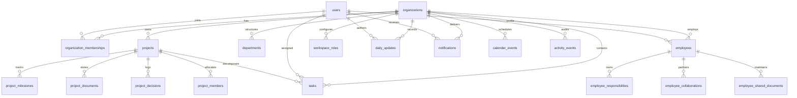

# Teamden by shed — Developer Reference Guide & Master Architecture

Comprehensive developer reference document detailing database connection parameters, complete 28-table relational schema data dictionary (V1–V11), active accounts and credentials, REST API specifications, frontend architecture, and automated test suite matrix.

---

## 1. Environment & Architecture Overview

| Component | Technology | Version / Configuration |
| :--- | :--- | :--- |
| **Backend Framework** | Spring Boot | 3.5.x (Java 17 / 21) |
| **Relational Database** | PostgreSQL | 17 / 16 (Local Port 5432) |
| **Database Migrations** | Flyway | 11 Migrations (`src/main/resources/db/migration`) |
| **Web Application** | Vanilla HTML5 / Modern CSS / ES6 JS | Served from `src/main/resources/static` |
| **Design System** | Neo-Editorial Token Architecture | `fragments/theme/theme.css` (Strict Zero-Hex) |
| **Primary Typography** | Inter, Inter Tight, Montserrat, Unbounded | `fragments/fonts/fonts.css` |
| **Authentication** | Spring Security + HttpSession | Cookie: `TEAMDEN_SESSION` (Lax, HttpOnly) |
| **Password Encoder** | BCrypt | Strength: 12 rounds |
| **Default Web Port** | HTTP | `8080` (`http://localhost:8080`) |
| **Default DB Port** | TCP | `5432` (`localhost:5432`) |

---

## 2. Database Connection & Credentials

| Parameter | Configuration Value | Environment Variable Override |
| :--- | :--- | :--- |
| **Host** | `localhost` (127.0.0.1) | — |
| **Port** | `5432` | — |
| **Database Name** | `teamden` | — |
| **Username** | `postgres` | `DB_USERNAME` |
| **Password** | `[Configured via DB_PASSWORD]` | `DB_PASSWORD` (Default: `crazy@8`) |
| **JDBC URL** | `jdbc:postgresql://localhost:5432/teamden` | `DB_URL` |
| **Driver Class** | `org.postgresql.Driver` | — |
| **Connection Pool** | HikariCP (Max: 10, Min Idle: 2) | — |

### Direct Connection via PSQL
```powershell
$env:PGPASSWORD=$env:DB_PASSWORD; & 'C:\Program Files\PostgreSQL\17\bin\psql.exe' -U postgres -d teamden
```

---

## 3. Master Relational Schema & Data Dictionary (28 Tables)

Teamden utilizes 28 relational business tables plus 1 Flyway migration history table.



### 3.1. `organizations` (V1)
Root tenant workspace table isolating all organizational data.
| Column | Type | Nullable | Default | Description |
| :--- | :--- | :--- | :--- | :--- |
| `id` | `UUID` | **NO** | — | Primary Key |
| `name` | `VARCHAR(150)` | **NO** | — | Workspace / Company Name |
| `status` | `VARCHAR(30)` | **NO** | `'ACTIVE'` | `ACTIVE`, `SUSPENDED`, `ARCHIVED` |
| `created_at` | `TIMESTAMPTZ` | **NO** | `CURRENT_TIMESTAMP` | Creation timestamp |
| `updated_at` | `TIMESTAMPTZ` | **NO** | `CURRENT_TIMESTAMP` | Last updated timestamp |

---

### 3.2. `users` (V1)
Global identity accounts and authentication credentials.
| Column | Type | Nullable | Default | Description |
| :--- | :--- | :--- | :--- | :--- |
| `id` | `UUID` | **NO** | — | Primary Key |
| `full_name` | `VARCHAR(150)` | **NO** | — | Display name |
| `email` | `VARCHAR(255)` | **NO** | — | Unique login email (`uk_users_email`) |
| `password_hash` | `VARCHAR(255)` | **NO** | — | BCrypt password hash (12 rounds) |
| `status` | `VARCHAR(30)` | **NO** | `'ACTIVE'` | `ACTIVE`, `DISABLED`, `PENDING_INVITE` |
| `created_at` | `TIMESTAMPTZ` | **NO** | `CURRENT_TIMESTAMP` | Creation timestamp |
| `updated_at` | `TIMESTAMPTZ` | **NO** | `CURRENT_TIMESTAMP` | Last updated timestamp |
| `last_login_at` | `TIMESTAMPTZ` | YES | `NULL` | Last successful login |

---

### 3.3. `organization_memberships` (V1)
Maps users to organizations with role-based access control.
| Column | Type | Nullable | Default | Description |
| :--- | :--- | :--- | :--- | :--- |
| `id` | `UUID` | **NO** | — | Primary Key |
| `organization_id` | `UUID` | **NO** | — | Foreign Key -> `organizations(id)` ON DELETE CASCADE |
| `user_id` | `UUID` | **NO** | — | Foreign Key -> `users(id)` ON DELETE CASCADE |
| `role` | `VARCHAR(30)` | **NO** | — | `OWNER`, `ADMIN`, `MEMBER`, `GUEST` |
| `status` | `VARCHAR(30)` | **NO** | `'ACTIVE'` | `ACTIVE`, `SUSPENDED` |
| `created_at` | `TIMESTAMPTZ` | **NO** | `CURRENT_TIMESTAMP` | Membership creation timestamp |

- **Unique Constraint:** `(organization_id, user_id)`
- **Indexes:** `idx_memberships_org`, `idx_memberships_user`

---

### 3.4. `projects` (V1, V2)
Workspace projects with health indicators and timelines.
| Column | Type | Nullable | Default | Description |
| :--- | :--- | :--- | :--- | :--- |
| `id` | `UUID` | **NO** | — | Primary Key |
| `organization_id` | `UUID` | **NO** | — | Foreign Key -> `organizations(id)` ON DELETE CASCADE |
| `name` | `VARCHAR(200)` | **NO** | — | Project Name |
| `description` | `TEXT` | YES | `NULL` | Detailed scope & deliverables |
| `status` | `VARCHAR(30)` | **NO** | `'ACTIVE'` | `PLANNING`, `ACTIVE`, `COMPLETED`, `ON_HOLD` |
| `health` | `VARCHAR(30)` | **NO** | `'ON_TRACK'` | `ON_TRACK`, `AT_RISK`, `OFF_TRACK` |
| `priority` | `VARCHAR(30)` | **NO** | `'MEDIUM'` | `LOW`, `MEDIUM`, `HIGH`, `URGENT` |
| `project_type` | `VARCHAR(100)` | YES | `'General'` | Category/Type e.g. `Design / Development` |
| `owner_id` | `UUID` | YES | `NULL` | Foreign Key -> `users(id)` (Project Lead) |
| `start_date` | `DATE` | YES | `NULL` | Planned start date |
| `due_date` | `DATE` | YES | `NULL` | Planned completion date |
| `created_at` | `TIMESTAMPTZ` | **NO** | `CURRENT_TIMESTAMP` | Project creation timestamp |
| `updated_at` | `TIMESTAMPTZ` | **NO** | `CURRENT_TIMESTAMP` | Last updated timestamp |

- **Indexes:** `idx_projects_org_status`

---

### 3.5. `tasks` (V1, V3)
Work items with Kanban column placement (`kanban_column`), order, and status.
| Column | Type | Nullable | Default | Description |
| :--- | :--- | :--- | :--- | :--- |
| `id` | `UUID` | **NO** | — | Primary Key |
| `organization_id` | `UUID` | **NO** | — | Foreign Key -> `organizations(id)` ON DELETE CASCADE |
| `project_id` | `UUID` | YES | `NULL` | Foreign Key -> `projects(id)` ON DELETE CASCADE |
| `milestone_id` | `UUID` | YES | `NULL` | Foreign Key -> `project_milestones(id)` |
| `task_code` | `VARCHAR(50)` | YES | `NULL` | Display code e.g. `T-014` |
| `title` | `VARCHAR(255)` | **NO** | — | Task title |
| `description` | `TEXT` | YES | `NULL` | Task details / acceptance criteria |
| `assignee_id` | `UUID` | YES | `NULL` | Foreign Key -> `users(id)` |
| `creator_id` | `UUID` | **NO** | — | Foreign Key -> `users(id)` |
| `priority` | `VARCHAR(30)` | **NO** | `'MEDIUM'` | `LOW`, `MEDIUM`, `HIGH`, `URGENT` |
| `status` | `VARCHAR(30)` | **NO** | `'TODO'` | `TODO`, `IN_PROGRESS`, `IN_REVIEW`, `DONE` |
| `kanban_column` | `VARCHAR(30)` | **NO** | `'NOW'` | `NOW`, `NEXT`, `LATER` (V3) |
| `kanban_order` | `INTEGER` | **NO** | `0` | Positional order within column (V3) |
| `is_blocked` | `BOOLEAN` | **NO** | `FALSE` | Explicit blocker flag |
| `blocker_reason` | `VARCHAR(255)` | YES | `NULL` | Blocker dependency description |
| `subtasks_count` | `INTEGER` | **NO** | `0` | Cached count of subtasks |
| `due_date` | `DATE` | YES | `NULL` | Due date |
| `completed_at` | `TIMESTAMPTZ` | YES | `NULL` | Timestamp when marked DONE |
| `created_at` | `TIMESTAMPTZ` | **NO** | `CURRENT_TIMESTAMP` | Task creation timestamp |
| `updated_at` | `TIMESTAMPTZ` | **NO** | `CURRENT_TIMESTAMP` | Last updated timestamp |

- **Indexes:** `idx_tasks_org_status`, `idx_tasks_org_assignee`, `idx_tasks_kanban_col`

---

### 3.6. `task_subtasks` (V1, V2)
Checklist items linked to parent tasks.
| Column | Type | Nullable | Default | Description |
| :--- | :--- | :--- | :--- | :--- |
| `id` | `UUID` | **NO** | — | Primary Key |
| `organization_id` | `UUID` | **NO** | — | Foreign Key -> `organizations(id)` |
| `task_id` | `UUID` | **NO** | — | Foreign Key -> `tasks(id)` ON DELETE CASCADE |
| `title` | `VARCHAR(255)` | **NO** | — | Subtask description |
| `is_completed` | `BOOLEAN` | **NO** | `FALSE` | Completion status |
| `seq_num` | `INTEGER` | **NO** | `1` | Positional ordering |
| `created_at` | `TIMESTAMPTZ` | **NO** | `CURRENT_TIMESTAMP` | Creation timestamp |
| `updated_at` | `TIMESTAMPTZ` | **NO** | `CURRENT_TIMESTAMP` | Last updated timestamp |

---

### 3.7. `task_linked_documents` (V3)
Cross-reference mapping between tasks and project documents.
| Column | Type | Nullable | Default | Description |
| :--- | :--- | :--- | :--- | :--- |
| `id` | `UUID` | **NO** | — | Primary Key |
| `organization_id` | `UUID` | **NO** | — | Foreign Key -> `organizations(id)` |
| `task_id` | `UUID` | **NO** | — | Foreign Key -> `tasks(id)` ON DELETE CASCADE |
| `document_id` | `UUID` | **NO** | — | Foreign Key -> `project_documents(id)` ON DELETE CASCADE |
| `created_at` | `TIMESTAMPTZ` | **NO** | `CURRENT_TIMESTAMP` | Creation timestamp |

---

### 3.8. `project_members` (V2)
Project team allocations and project-specific roles.
| Column | Type | Nullable | Default | Description |
| :--- | :--- | :--- | :--- | :--- |
| `id` | `UUID` | **NO** | — | Primary Key |
| `organization_id` | `UUID` | **NO** | — | Foreign Key -> `organizations(id)` |
| `project_id` | `UUID` | **NO** | — | Foreign Key -> `projects(id)` ON DELETE CASCADE |
| `user_id` | `UUID` | **NO** | — | Foreign Key -> `users(id)` ON DELETE CASCADE |
| `role` | `VARCHAR(50)` | **NO** | `'CONTRIBUTOR'` | `LEAD`, `DESIGNER`, `DEVELOPER`, `CONTRIBUTOR` |
| `created_at` | `TIMESTAMPTZ` | **NO** | `CURRENT_TIMESTAMP` | Creation timestamp |

---

### 3.9. `project_specifications` (V2)
Strategic goals, deliverables breakdown, and project context.
| Column | Type | Nullable | Default | Description |
| :--- | :--- | :--- | :--- | :--- |
| `id` | `UUID` | **NO** | — | Primary Key |
| `organization_id` | `UUID` | **NO** | — | Foreign Key -> `organizations(id)` |
| `project_id` | `UUID` | **NO** | — | Foreign Key -> `projects(id)` (Unique, Cascade) |
| `title` | `VARCHAR(255)` | **NO** | — | Specification title |
| `objectives` | `TEXT` | YES | `NULL` | Strategic objectives list |
| `deliverables` | `TEXT` | YES | `NULL` | Deliverables breakdown |
| `success_criteria` | `TEXT` | YES | `NULL` | Acceptance and KPI criteria |
| `client_name` | `VARCHAR(150)` | YES | `NULL` | Client / stakeholder name |
| `focus_area` | `VARCHAR(255)` | YES | `NULL` | Strategic focus area |
| `created_at` | `TIMESTAMPTZ` | **NO** | `CURRENT_TIMESTAMP` | Creation timestamp |
| `updated_at` | `TIMESTAMPTZ` | **NO** | `CURRENT_TIMESTAMP` | Last updated timestamp |

---

### 3.10. `project_decisions` (V2)
Decision register tracking sign-offs, approvals, and stakeholders.
| Column | Type | Nullable | Default | Description |
| :--- | :--- | :--- | :--- | :--- |
| `id` | `UUID` | **NO** | — | Primary Key |
| `organization_id` | `UUID` | **NO** | — | Foreign Key -> `organizations(id)` |
| `project_id` | `UUID` | **NO** | — | Foreign Key -> `projects(id)` ON DELETE CASCADE |
| `decision_code` | `VARCHAR(50)` | YES | `NULL` | Decision code e.g. `DEC-01` |
| `title` | `VARCHAR(255)` | **NO** | — | Decision title / headline |
| `sub_title` | `VARCHAR(255)` | YES | `NULL` | Secondary summary line |
| `description` | `TEXT` | YES | `NULL` | Decision rationale & scope |
| `status` | `VARCHAR(30)` | **NO** | `'PENDING'` | `PENDING`, `APPROVED`, `REJECTED`, `IN_REVIEW` |
| `due_date` | `DATE` | YES | `NULL` | Decision due date |
| `decider_id` | `UUID` | YES | `NULL` | Foreign Key -> `users(id)` |
| `action_url` | `VARCHAR(255)` | YES | `NULL` | Review workflow link |
| `action_label` | `VARCHAR(100)` | YES | `NULL` | Action button text |
| `decided_at` | `TIMESTAMPTZ` | YES | `NULL` | Sign-off timestamp |
| `created_at` | `TIMESTAMPTZ` | **NO** | `CURRENT_TIMESTAMP` | Creation timestamp |
| `updated_at` | `TIMESTAMPTZ` | **NO** | `CURRENT_TIMESTAMP` | Last updated timestamp |

---

### 3.11. `project_documents` (V2)
Project knowledge base repository (specs, briefs, notes, design assets).
| Column | Type | Nullable | Default | Description |
| :--- | :--- | :--- | :--- | :--- |
| `id` | `UUID` | **NO** | — | Primary Key |
| `organization_id` | `UUID` | **NO** | — | Foreign Key -> `organizations(id)` |
| `project_id` | `UUID` | **NO** | — | Foreign Key -> `projects(id)` ON DELETE CASCADE |
| `doc_number` | `VARCHAR(50)` | **NO** | — | Display number e.g. `DOCUMENT / 001` |
| `title` | `VARCHAR(255)` | **NO** | — | Document title |
| `category` | `VARCHAR(50)` | **NO** | `'Meeting Notes'` | Category label |
| `category_key` | `VARCHAR(30)` | **NO** | `'Notes'` | Filter category (`Notes`, `Plans`, `Design`, `Other`) |
| `file_type` | `VARCHAR(30)` | **NO** | `'DOC'` | File extension (`DOC`, `PDF`, `FIGMA`, `NOTE`) |
| `file_size` | `VARCHAR(50)` | YES | `NULL` | File size display string |
| `file_url` | `VARCHAR(500)` | YES | `NULL` | Link or external asset URL |
| `content` | `TEXT` | YES | `NULL` | Rich text or markdown body |
| `author_id` | `UUID` | YES | `NULL` | Foreign Key -> `users(id)` |
| `is_pinned` | `BOOLEAN` | **NO** | `FALSE` | Pinned status in library |
| `created_at` | `TIMESTAMPTZ` | **NO** | `CURRENT_TIMESTAMP` | Creation timestamp |
| `updated_at` | `TIMESTAMPTZ` | **NO** | `CURRENT_TIMESTAMP` | Last updated timestamp |

---

### 3.12. `project_document_collaborators` (V2)
Meeting attendees and document contributors.
| Column | Type | Nullable | Default | Description |
| :--- | :--- | :--- | :--- | :--- |
| `id` | `UUID` | **NO** | — | Primary Key |
| `organization_id` | `UUID` | **NO** | — | Foreign Key -> `organizations(id)` |
| `document_id` | `UUID` | **NO** | — | Foreign Key -> `project_documents(id)` ON DELETE CASCADE |
| `user_id` | `UUID` | **NO** | — | Foreign Key -> `users(id)` ON DELETE CASCADE |
| `role` | `VARCHAR(30)` | **NO** | `'COLLABORATOR'` | `AUTHOR`, `COLLABORATOR`, `ATTENDEE` |
| `created_at` | `TIMESTAMPTZ` | **NO** | `CURRENT_TIMESTAMP` | Creation timestamp |

---

### 3.13. `project_milestones` (V6)
Ordered delivery stages tracking milestone progress (Discovery to Scale).
| Column | Type | Nullable | Default | Description |
| :--- | :--- | :--- | :--- | :--- |
| `id` | `UUID` | **NO** | — | Primary Key |
| `organization_id` | `UUID` | **NO** | — | Foreign Key -> `organizations(id)` |
| `project_id` | `UUID` | **NO** | — | Foreign Key -> `projects(id)` ON DELETE CASCADE |
| `seq_num` | `INTEGER` | **NO** | — | Sequence number (1 to 9) |
| `code` | `VARCHAR(20)` | **NO** | — | Stage code e.g. `01`, `06` |
| `name` | `VARCHAR(150)` | **NO** | — | Stage name |
| `description` | `TEXT` | YES | `NULL` | Deliverable scope |
| `status` | `VARCHAR(30)` | **NO** | `'UPCOMING'` | `UPCOMING`, `CURRENT`, `COMPLETED`, `DELAYED` |
| `status_label` | `VARCHAR(50)` | YES | `NULL` | Human display label |
| `due_date` | `DATE` | YES | `NULL` | Target completion date |
| `completed_at` | `TIMESTAMPTZ` | YES | `NULL` | Completion timestamp |
| `created_at` | `TIMESTAMPTZ` | **NO** | `CURRENT_TIMESTAMP` | Creation timestamp |
| `updated_at` | `TIMESTAMPTZ` | **NO** | `CURRENT_TIMESTAMP` | Last updated timestamp |

---

### 3.14. `activity_events` (V1, V6, V7)
Immutable audit trail and project chronicle movements.
| Column | Type | Nullable | Default | Description |
| :--- | :--- | :--- | :--- | :--- |
| `id` | `UUID` | **NO** | — | Primary Key |
| `organization_id` | `UUID` | **NO** | — | Foreign Key -> `organizations(id)` |
| `actor_id` | `UUID` | YES | `NULL` | Foreign Key -> `users(id)` |
| `project_id` | `UUID` | YES | `NULL` | Foreign Key -> `projects(id)` |
| `task_id` | `UUID` | YES | `NULL` | Foreign Key -> `tasks(id)` |
| `event_type` | `VARCHAR(50)` | **NO** | — | Event identifier |
| `category_key` | `VARCHAR(50)` | YES | `'TASK'` | `TASK`, `DOCUMENT`, `ASSIGNMENT`, `COMMENT` (V7) |
| `icon_type` | `VARCHAR(50)` | YES | `'check'` | Lucide icon identifier (V7) |
| `title` | `VARCHAR(255)` | **NO** | — | Action headline |
| `description` | `VARCHAR(500)` | YES | `NULL` | Action narrative details |
| `event_timestamp` | `TIMESTAMPTZ` | **NO** | `CURRENT_TIMESTAMP` | Exact occurrence time |

---

### 3.15. `attendance_records` (V6)
Employee daily attendance and punch logs.
| Column | Type | Nullable | Default | Description |
| :--- | :--- | :--- | :--- | :--- |
| `id` | `UUID` | **NO** | — | Primary Key |
| `organization_id` | `UUID` | **NO** | — | Foreign Key -> `organizations(id)` |
| `employee_id` | `UUID` | **NO** | — | Foreign Key -> `users(id)` |
| `attendance_date` | `DATE` | **NO** | — | Work date |
| `check_in_time` | `TIMESTAMPTZ` | **NO** | — | Clock-in timestamp |
| `check_out_time` | `TIMESTAMPTZ` | YES | `NULL` | Clock-out timestamp |
| `status` | `VARCHAR(30)` | **NO** | `'PRESENT'` | `PRESENT`, `HALF_DAY`, `ON_LEAVE`, `ABSENT` |
| `created_at` | `TIMESTAMPTZ` | **NO** | `CURRENT_TIMESTAMP` | Record creation timestamp |
| `updated_at` | `TIMESTAMPTZ` | **NO** | `CURRENT_TIMESTAMP` | Last updated timestamp |

---

### 3.16. `calendar_events` (V4)
Meetings, sprints, design reviews, and calendar deadlines.
| Column | Type | Nullable | Default | Description |
| :--- | :--- | :--- | :--- | :--- |
| `id` | `UUID` | **NO** | — | Primary Key |
| `organization_id` | `UUID` | **NO** | — | Foreign Key -> `organizations(id)` |
| `project_id` | `UUID` | YES | `NULL` | Foreign Key -> `projects(id)` |
| `host_id` | `UUID` | YES | `NULL` | Foreign Key -> `users(id)` |
| `title` | `VARCHAR(255)` | **NO** | — | Meeting / event title |
| `description` | `TEXT` | YES | `NULL` | Meeting notes and agenda |
| `start_time` | `TIMESTAMPTZ` | **NO** | — | Scheduled start |
| `end_time` | `TIMESTAMPTZ` | **NO** | — | Scheduled end |
| `location` | `VARCHAR(255)` | YES | `NULL` | Conference link / room |
| `created_at` | `TIMESTAMPTZ` | **NO** | `CURRENT_TIMESTAMP` | Creation timestamp |

---

### 3.17. `calendar_sources` (V5)
Connected external and internal calendar synchronization sources.
| Column | Type | Nullable | Default | Description |
| :--- | :--- | :--- | :--- | :--- |
| `id` | `UUID` | **NO** | — | Primary Key |
| `organization_id` | `UUID` | **NO** | — | Foreign Key -> `organizations(id)` |
| `name` | `VARCHAR(100)` | **NO** | — | Source name e.g. `Client Calendar` |
| `color_token` | `VARCHAR(50)` | **NO** | `'#7B61FF'` | Display color accent |
| `is_active` | `BOOLEAN` | **NO** | `TRUE` | Active sync state |

---

### 3.18. `calendar_commitments` (V5)
Fixed delivery commitments and hard milestones displayed on calendar.
| Column | Type | Nullable | Default | Description |
| :--- | :--- | :--- | :--- | :--- |
| `id` | `UUID` | **NO** | — | Primary Key |
| `organization_id` | `UUID` | **NO** | — | Foreign Key -> `organizations(id)` |
| `user_id` | `UUID` | YES | `NULL` | Foreign Key -> `users(id)` |
| `title` | `VARCHAR(255)` | **NO** | — | Commitment title |
| `due_date` | `DATE` | **NO** | — | Target completion date |
| `priority` | `VARCHAR(30)` | **NO** | `'HIGH'` | `LOW`, `MEDIUM`, `HIGH` |

---

### 3.19. `calendar_team_availability` (V5)
Team working hours and member availability states.
| Column | Type | Nullable | Default | Description |
| :--- | :--- | :--- | :--- | :--- |
| `id` | `UUID` | **NO** | — | Primary Key |
| `organization_id` | `UUID` | **NO** | — | Foreign Key -> `organizations(id)` |
| `user_id` | `UUID` | **NO** | — | Foreign Key -> `users(id)` |
| `availability_state` | `VARCHAR(50)` | **NO** | `'AVAILABLE'` | `AVAILABLE`, `IN_MEETING`, `AWAY`, `FOCUS` |
| `weekly_hours` | `INTEGER` | **NO** | `40` | Weekly working capacity |

---

### 3.20. `calendar_needs_scheduling` (V5)
Unscheduled meetings and backlog session requests.
| Column | Type | Nullable | Default | Description |
| :--- | :--- | :--- | :--- | :--- |
| `id` | `UUID` | **NO** | — | Primary Key |
| `organization_id` | `UUID` | **NO** | — | Foreign Key -> `organizations(id)` |
| `title` | `VARCHAR(255)` | **NO** | — | Unscheduled item headline |
| `duration_minutes` | `INTEGER` | **NO** | `30` | Expected meeting duration |
| `priority` | `VARCHAR(30)` | **NO** | `'MEDIUM'` | Urgency priority |

---

### 3.21. `daily_updates` (V8, V9)
Standup updates with completed work, next priorities, blockers, and image attachments.
| Column | Type | Nullable | Default | Description |
| :--- | :--- | :--- | :--- | :--- |
| `id` | `UUID` | **NO** | — | Primary Key |
| `organization_id` | `UUID` | **NO** | — | Foreign Key -> `organizations(id)` |
| `user_id` | `UUID` | **NO** | — | Foreign Key -> `users(id)` |
| `update_date` | `DATE` | **NO** | — | Standup date |
| `what_worked_on` | `TEXT` | YES | `NULL` | Completed tasks summary |
| `what_working_on_next` | `TEXT` | YES | `NULL` | Next priority items |
| `blockers_dependencies` | `TEXT` | YES | `NULL` | Impediments / dependencies |
| `health_status` | `VARCHAR(30)` | **NO** | `'ON_TRACK'` | `ON_TRACK`, `BLOCKED`, `IN_REVIEW` |
| `velocity_status` | `VARCHAR(30)` | YES | `'NORMAL'` | `HIGH_VELOCITY`, `NORMAL` |
| `reference_image_url` | `VARCHAR(1000)`| YES | `NULL` | Uploaded screenshot reference URL (V9) |
| `reference_image_name`| `VARCHAR(255)` | YES | `NULL` | Attachment filename (V9) |
| `is_submitted` | `BOOLEAN` | **NO** | `TRUE` | Submission flag |
| `created_at` | `TIMESTAMPTZ` | **NO** | `CURRENT_TIMESTAMP` | Creation timestamp |

---

### 3.22. `notifications` (V10)
Inbox notifications (mentions, assignments, decision approvals, controls).
| Column | Type | Nullable | Default | Description |
| :--- | :--- | :--- | :--- | :--- |
| `id` | `UUID` | **NO** | — | Primary Key |
| `organization_id` | `UUID` | **NO** | — | Foreign Key -> `organizations(id)` |
| `recipient_id` | `UUID` | **NO** | — | Foreign Key -> `users(id)` |
| `sender_id` | `UUID` | YES | `NULL` | Foreign Key -> `users(id)` |
| `project_id` | `UUID` | YES | `NULL` | Foreign Key -> `projects(id)` |
| `category` | `VARCHAR(50)` | **NO** | `'UPDATES'` | `ATTENTION`, `UPDATES`, `MENTIONS`, `FOLLOWING` |
| `notification_type`| `VARCHAR(50)` | **NO** | — | `APPROVAL`, `FEEDBACK`, `HANDOFF`, `MENTION` |
| `title` | `VARCHAR(255)` | **NO** | — | Headline |
| `message` | `TEXT` | YES | `NULL` | Notification body / quoted snippet |
| `action_url` | `VARCHAR(255)` | YES | `NULL` | Target action route |
| `is_read` | `BOOLEAN` | **NO** | `FALSE` | Read status |
| `is_actionable` | `BOOLEAN` | **NO** | `FALSE` | Whether it appears in Attention Queue |
| `is_snoozed` | `BOOLEAN` | **NO** | `FALSE` | Snooze state |
| `created_at` | `TIMESTAMPTZ` | **NO** | `CURRENT_TIMESTAMP` | Occurrence timestamp |

---

### 3.23. `departments` (V11)
Organizational departments (Design, Engineering, Marketing, Operations).
| Column | Type | Nullable | Default | Description |
| :--- | :--- | :--- | :--- | :--- |
| `id` | `UUID` | **NO** | — | Primary Key |
| `organization_id` | `UUID` | **NO** | — | Foreign Key -> `organizations(id)` ON DELETE CASCADE |
| `name` | `VARCHAR(150)` | **NO** | — | Department name |
| `description` | `VARCHAR(255)` | YES | `NULL` | Department mission |
| `head_user_id` | `UUID` | YES | `NULL` | Foreign Key -> `users(id)` |
| `created_at` | `TIMESTAMPTZ` | **NO** | `CURRENT_TIMESTAMP` | Creation timestamp |

---

### 3.24. `employees` (V11)
Public employee profiles, job titles, bio, and department assignments.
| Column | Type | Nullable | Default | Description |
| :--- | :--- | :--- | :--- | :--- |
| `id` | `UUID` | **NO** | — | Primary Key |
| `organization_id` | `UUID` | **NO** | — | Foreign Key -> `organizations(id)` ON DELETE CASCADE |
| `department_id` | `UUID` | YES | `NULL` | Foreign Key -> `departments(id)` ON DELETE SET NULL |
| `user_id` | `UUID` | YES | `NULL` | Foreign Key -> `users(id)` ON DELETE SET NULL |
| `full_name` | `VARCHAR(150)` | **NO** | — | Full name |
| `job_title` | `VARCHAR(150)` | **NO** | — | Position title |
| `bio` | `TEXT` | YES | `NULL` | Professional biography |
| `avatar_initials` | `VARCHAR(10)` | YES | `NULL` | Avatar monogram e.g. `AR` |
| `avatar_color` | `VARCHAR(50)` | YES | `'lavender'` | Background pastel tint (`peach`, `lavender`, `blue`, `green`) |
| `is_active` | `BOOLEAN` | **NO** | `TRUE` | Active employment state |
| `created_at` | `TIMESTAMPTZ` | **NO** | `CURRENT_TIMESTAMP` | Record creation timestamp |

---

### 3.25. `employee_responsibilities` (V11)
Granular ownership items assigned to individual employees.
| Column | Type | Nullable | Default | Description |
| :--- | :--- | :--- | :--- | :--- |
| `id` | `UUID` | **NO** | — | Primary Key |
| `employee_id` | `UUID` | **NO** | — | Foreign Key -> `employees(id)` ON DELETE CASCADE |
| `title` | `VARCHAR(255)` | **NO** | — | Responsibility title |
| `is_primary` | `BOOLEAN` | **NO** | `FALSE` | Highlight purple row flag |
| `created_at` | `TIMESTAMPTZ` | **NO** | `CURRENT_TIMESTAMP` | Creation timestamp |

---

### 3.26. `workspace_roles` (V11)
Organizational roles and permission summaries.
| Column | Type | Nullable | Default | Description |
| :--- | :--- | :--- | :--- | :--- |
| `id` | `UUID` | **NO** | — | Primary Key |
| `organization_id` | `UUID` | **NO** | — | Foreign Key -> `organizations(id)` ON DELETE CASCADE |
| `name` | `VARCHAR(100)` | **NO** | — | Role name (`Workspace Owner`, `Administrator`, etc.) |
| `description` | `VARCHAR(255)` | YES | `NULL` | Role scope |
| `member_count` | `INTEGER` | **NO** | `0` | Active count pill |
| `permissions_summary`| `VARCHAR(500)`| YES | `NULL` | Summary of role capabilities |
| `created_at` | `TIMESTAMPTZ` | **NO** | `CURRENT_TIMESTAMP` | Creation timestamp |

---

### 3.27. `employee_collaborations` (V11)
Active peer collaborations displayed in employee drawer.
| Column | Type | Nullable | Default | Description |
| :--- | :--- | :--- | :--- | :--- |
| `id` | `UUID` | **NO** | — | Primary Key |
| `employee_id` | `UUID` | **NO** | — | Foreign Key -> `employees(id)` ON DELETE CASCADE |
| `collaborator_user_id`| `UUID` | YES | `NULL` | Foreign Key -> `users(id)` |
| `collaborator_name` | `VARCHAR(150)` | **NO** | — | Partner name e.g. `Peter K.` |
| `project_name` | `VARCHAR(150)` | **NO** | — | Collaboration initiative |
| `status_text` | `VARCHAR(150)` | YES | `NULL` | Status e.g. `Feedback pending` |
| `avatar_initials` | `VARCHAR(10)` | YES | `'PK'` | Monogram |
| `created_at` | `TIMESTAMPTZ` | **NO** | `CURRENT_TIMESTAMP` | Creation timestamp |

---

### 3.28. `employee_shared_documents` (V11)
Knowledge base artifacts maintained by employees.
| Column | Type | Nullable | Default | Description |
| :--- | :--- | :--- | :--- | :--- |
| `id` | `UUID` | **NO** | — | Primary Key |
| `employee_id` | `UUID` | **NO** | — | Foreign Key -> `employees(id)` ON DELETE CASCADE |
| `title` | `VARCHAR(255)` | **NO** | — | Document title e.g. `Component Specifications` |
| `subtitle` | `VARCHAR(255)` | YES | `NULL` | Document context description |
| `document_url` | `VARCHAR(500)` | YES | `NULL` | Link or route |
| `created_at` | `TIMESTAMPTZ` | **NO** | `CURRENT_TIMESTAMP` | Creation timestamp |

---

### 3.29. `flyway_schema_history`
Flyway automated migration tracking table.

---

## 4. Backend Architecture & Domain Module Matrix

| Package Name | JPA Entities | Repositories | Services | Controllers | Scoping |
|:---|:---|:---|:---|:---|:---|
| `com.shed.teamden.activity` | `ActivityEvent` | `ActivityEventRepository` | `ActivityService` | `ActivityController` | `organization_id` |
| `com.shed.teamden.attendance` | `AttendanceRecord` | `AttendanceRecordRepository` | — | — | `organization_id` |
| `com.shed.teamden.auth` | — | — | `AuthService` | `AuthController` | Session cookie |
| `com.shed.teamden.calendar` | `CalendarEvent`, `CalendarCommitment`, `CalendarNeedsScheduling`, `CalendarSource`, `CalendarTeamAvailability` | 5 Repositories | `CalendarService` | `CalendarController` | `organization_id` |
| `com.shed.teamden.dailyupdate` | `DailyUpdate` | `DailyUpdateRepository` | `DailyUpdateService` | `DailyUpdateController` | `organization_id` |
| `com.shed.teamden.dashboard` | — | — | `DashboardService` | `DashboardController` | `organization_id` |
| `com.shed.teamden.dev` | — | — | `DevPortalService` | `DevPortalController` | Public Dev Mode |
| `com.shed.teamden.employee` | `Department`, `Employee`, `EmployeeResponsibility`, `WorkspaceRole`, `EmployeeCollaboration`, `EmployeeSharedDocument` | 6 Repositories | `EmployeeService` | `EmployeeController` | `organization_id` |
| `com.shed.teamden.notification` | `Notification` | `NotificationRepository` | `NotificationService` | `NotificationController` | `organization_id` |
| `com.shed.teamden.organization` | `Organization`, `OrganizationMembership` | 2 Repositories | `SetupService` | `SetupController` | Multi-Tenant Root |
| `com.shed.teamden.project` | `Project`, `ProjectDecision`, `ProjectDocument`, `ProjectDocumentCollaborator`, `ProjectMember`, `ProjectMilestone`, `ProjectSpecification` | 7 Repositories | `ProjectService`, `ProjectMilestoneService` | `ProjectController`, `ProjectMilestoneController` | `organization_id` |
| `com.shed.teamden.search` | — | — | `GlobalSearchService` | `GlobalSearchController` | `organization_id` |
| `com.shed.teamden.security` | — | — | `CustomUserDetailsService` | — | Filter Chain |
| `com.shed.teamden.task` | `Task`, `TaskLinkedDocument`, `TaskSubtask` | 3 Repositories | `TaskService` | `TaskController` | `organization_id` |
| `com.shed.teamden.user` | `User` | `UserRepository` | — | — | Auth / Security |

---

## 5. REST API Catalog

Base URL: `http://localhost:8080`

| Domain | Method | Endpoint | Request Payload / Params | Response DTO | Auth Required |
|:---|:---|:---|:---|:---|:---:|
| **Auth** | `POST` | `/api/auth/login` | `LoginRequest` | `AuthResponse` | No |
| **Auth** | `POST` | `/api/auth/logout` | None | `ApiResponse<Void>` | Yes |
| **Auth** | `GET` | `/api/auth/session` | None | `AuthResponse` | Yes |
| **Auth** | `GET` | `/api/auth/csrf` | None | CSRF Token Cookie | No |
| **Setup** | `POST` | `/api/setup/register-company` | `RegisterCompanyRequest` | `AuthResponse` | No |
| **Dashboard** | `GET` | `/api/dashboard/today` | None | `TodayDashboardDto` | Yes |
| **Dashboard** | `POST` | `/api/dashboard/tasks/{id}/complete` | None | `TaskDto` | Yes |
| **Dashboard** | `POST` | `/api/dashboard/tasks/{id}/state` | `UpdateTaskStateRequest` | `TaskDto` | Yes |
| **Projects** | `GET` | `/api/projects` | None | `List<ProjectDto>` | Yes |
| **Projects** | `POST` | `/api/projects` | `CreateProjectRequest` | `ProjectDto` | Yes |
| **Projects** | `GET` | `/api/projects/{id}/overview` | None | `ProjectOverviewDto` | Yes |
| **Projects** | `GET` | `/api/projects/{id}/tasks` | None | `List<TaskDto>` | Yes |
| **Projects** | `GET` | `/api/projects/{id}/documents` | None | `List<ProjectDocumentDto>` | Yes |
| **Projects** | `POST` | `/api/projects/documents` | `CreateDocumentRequestDto` | `ProjectDocumentDto` | Yes |
| **Projects** | `GET` | `/api/projects/{id}/milestones` | None | `List<ProjectMilestoneDto>` | Yes |
| **Projects** | `POST` | `/api/projects/{id}/milestones` | `CreateMilestoneRequestDto` | `ProjectMilestoneDto` | Yes |
| **Tasks** | `POST` | `/api/tasks` | `CreateTaskRequest` | `TaskDto` | Yes |
| **Tasks** | `GET` | `/api/tasks/options` | None | `TaskCreationOptionsDto` | Yes |
| **Employees** | `GET` | `/api/employees/directory` | None | `EmployeeDirectoryResponseDto` | Yes |
| **Employees** | `GET` | `/api/employees/{id}` | None | `EmployeeDetailDto` | Yes |
| **Employees** | `POST` | `/api/employees` | `CreateEmployeeRequestDto` | `EmployeeDto` | Yes |
| **Employees** | `POST` | `/api/employees/{id}/responsibilities` | `AddResponsibilityRequestDto` | `EmployeeResponsibilityDto` | Yes |
| **Employees** | `DELETE`| `/api/employees/{id}/responsibilities/{respId}` | None | `ApiResponse<Void>` | Yes |
| **Employees** | `GET` | `/api/employees/roles` | None | `List<WorkspaceRoleDto>` | Yes |
| **Employees** | `GET` | `/api/employees/structure` | None | `List<TeamStructureNodeDto>` | Yes |
| **Notifications**| `GET` | `/api/notifications` | None | `List<NotificationDto>` | Yes |
| **Notifications**| `PUT` | `/api/notifications/{id}/read` | None | `NotificationDto` | Yes |
| **Notifications**| `POST`| `/api/notifications/mark-all-read` | None | `ApiResponse<Void>` | Yes |
| **Daily Update** | `GET` | `/api/daily-updates/today` | None | `DailyUpdateDto` | Yes |
| **Daily Update** | `POST`| `/api/daily-updates` | `CreateDailyUpdateRequestDto` | `DailyUpdateDto` | Yes |
| **Daily Update** | `GET` | `/api/daily-updates/suggestions` | None | `DailyUpdateSuggestionsDto` | Yes |
| **Search** | `GET` | `/api/search` | `q`, `category`, `limit` | `GlobalSearchResponseDto` | Yes |
| **Calendar** | `GET` | `/api/calendar/data` | None | `CalendarPageDataDto` | Yes |
| **Calendar** | `GET` | `/api/calendar/events` | `startDate`, `endDate` | `List<CalendarEventDto>` | Yes |
| **Calendar** | `GET` | `/api/calendar/events/{id}` | Path: `id` (UUID) | `CalendarEventDto` | Yes |
| **Calendar** | `POST`| `/api/calendar/events` | `CreateCalendarEventRequestDto` | `CalendarEventDto` | Yes |
| **Calendar** | `PUT` | `/api/calendar/events/{id}` | `UpdateCalendarEventRequestDto` | `CalendarEventDto` | Yes |
| **Calendar** | `PATCH`| `/api/calendar/events/{id}/notes` | `{"notes": "..."}` | `Map<String, String>` | Yes |
| **Calendar** | `PATCH`| `/api/calendar/events/{id}/agenda` | `{"agenda": "..."}` | `Map<String, String>` | Yes |
| **Calendar** | `PATCH`| `/api/calendar/events/{id}/decision`| `{"title": "...", "status": "..."}` | `Map<String, String>` | Yes |
| **Calendar** | `PATCH`| `/api/calendar/events/{id}/followups`| `{"followups": "[...]"}` | `Map<String, String>` | Yes |
| **Calendar** | `DELETE`| `/api/calendar/events/{id}` | Path: `id` (UUID) | Void (204) | Yes |
| **Activity** | `GET` | `/api/activity/events` | `range`, `category`, `limit` | `List<ActivityEventDto>` | Yes |
| **Dev Portal** | `GET` | `/api/dev/overview` | None | `DevOverviewDto` | No |
| **Dev Portal** | `GET` | `/api/dev/tables` | None | `List<TableMetadataDto>` | No |
| **Dev Portal** | `GET` | `/api/dev/tables/{name}/data` | `limit` (default: 50) | `TableDataDto` | No |
| **Dev Portal** | `GET` | `/api/dev/users` | None | `List<DevUserDto>` | No |
| **Dev Portal** | `POST`| `/api/dev/login-as/{userId}` | None | `AuthResponse` | No |

---

## 6. Frontend Neo-Editorial Views & Shell Architecture

| Route Path | View Purpose | CSS Stylesheet | Key Interactions |
|:---|:---|:---|:---|
| `/index.html` | Session Router | Inline styles | Redirects to `/pages/dashboard/dashboard.html` or login |
| `/pages/dashboard/dashboard.html` | 01 Today Dashboard | `dashboard.css` | Kanban board (Now, Next, Later), ticking date card |
| `/pages/projects/projects.html` | 02 Projects Directory | `projects.css` | Health pills, unassigned lead modal |
| `/pages/projects/project-detail/` | Project Details Suite | `project-detail.css` | Overview, Tasks, Documents, Milestones |
| `/pages/workspace/workspace.html` | 03 Workspace Root | `workspace.css` | Subnav tab strip |
| `/pages/workspace/employees/` | People & Roles | `employees.css` | 2-column pastel cards, sticky profile drawer, invite modal |
| `/pages/team/team.html` | 04 Team Directory | `team.css` | Member lists, department hubs |
| `/pages/calendar/calendar.html` | 05 Unified Calendar | `calendar.css` | Scheduling grid, team availability |
| `/pages/overview/overview.html` | 06 Executive Overview | `overview.css` | Executive pulse hero, milestone health |
| `/pages/overview/insights/` | 18 Insights Dashboard | `insights.css` | Velocity charts, workload balance |
| `/pages/inbox/inbox.html` | Inbox & Notifications | `inbox.css` | Attention Queue, Register, Action in Focus rail |
| `/pages/discovery/discovery.html` | Discovery Search Page | `discovery.css` | 3-column connected knowledge graph |
| `/pages/settings/settings.html` | Workspace Settings | `settings.css` | 5 category tab panes, roles & permission matrices |
| `/pages/calendar/meeting-detail/` | Meeting Details & Edit | `meeting-detail.css` | 2-column meeting canvas, notes, agenda, decisions |
| `/fragments/create/` | Universal Create Modal | `universal-create.css` | 2-column modal (Task, Project, Doc, Meeting) |
| `/fragments/search/` | Global Search Modal | `search-modal.css` | `Ctrl+K` translucent overlay with quick actions |
| `/dev use/dev use.html` | Developer Console | `dev use.css` | Dynamic table browser & test impersonator |

---

## 7. Automated Test Suite & Quality Matrix (103 Tests)

```text
Results:
Tests run: 103, Failures: 0, Errors: 0, Skipped: 0
BUILD SUCCESS
```

| Test Class | Module | Tests | Status |
|:---|:---|:---:|:---:|
| `ActivityIntegrationTest` | Audit & Activity | 8 | PASS |
| `AuthenticationIntegrationTest` | Auth & Sessions | 6 | PASS |
| `CalendarIntegrationTest` | Calendar Core | 6 | PASS |
| `MeetingDetailIntegrationTest` | Meeting Detail & Edit Experience | 9 | PASS |
| `DailyUpdateIntegrationTest` | Standup Updates | 6 | PASS |
| `DashboardKanbanIntegrationTest` | Kanban Transitions | 6 | PASS |
| `DevPortalIntegrationTest` | Developer Tools | 5 | PASS |
| `EmployeeIntegrationTest` | Workspace Employees | 5 | PASS |
| `GlobalSearchIntegrationTest` | Global Search & Discovery | 6 | PASS |
| `MultiOrganizationIsolationTest` | Security Boundaries | 7 | PASS |
| `NotificationIntegrationTest` | Inbox & Notifications | 7 | PASS |
| `ProjectFlowIntegrationTest` | Project Documents & Decisions | 5 | PASS |
| `ProjectIntegrationTest` | Projects Core | 8 | PASS |
| `ProjectMilestoneIntegrationTest`| Milestones 9-Stage Lifecycle | 6 | PASS |
| `SettingsIntegrationTest` | Workspace Settings & Role Permissions | 9 | PASS |
| `SetupIntegrationTest` | Company Onboarding | 3 | PASS |
| `TaskIntegrationTest` | Task Management | 3 | PASS |
| `TeamdenApplicationTests` | Application Context | 1 | PASS |
| **TOTAL** | **Full System Suite** | **103** | **100% GREEN** |

---

## 8. Developer Commands & Workflows

### 8.1. One-Click Launcher (`start.bat`)
```cmd
start.bat
```
1. Verifies PostgreSQL on port 5432 and auto-starts the service if stopped.
2. Checks port 8080 and kills any stale Java processes.
3. Spawns health monitor that opens Google Chrome when backend HTTP 200 is confirmed.
4. Launches Spring Boot server on `http://localhost:8080`.

### 8.2. Database Purge Utility (`purge_db.bat`)
Truncates all 32 relational tables while preserving the Flyway migration history:
```cmd
purge_db.bat --force
```

### 8.3. Maven Commands
```cmd
:: Compile all classes
.\mvnw.cmd compile

:: Run full test suite (103 tests)
.\mvnw.cmd test

:: Run application
.\mvnw.cmd spring-boot:run
```
